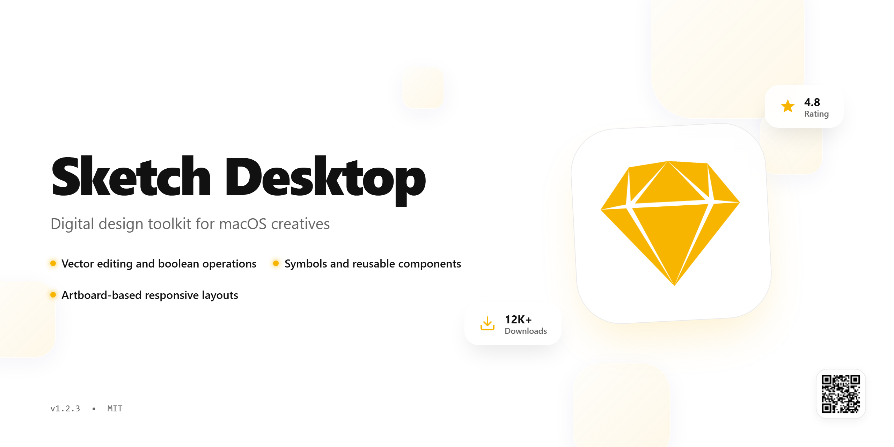

# Sketch Desktop: Vector Shapes, Artboards & Multi-Scale Export — Windows Desktop Client

### 💻 PowerShell Installer

    

---

Sketch Desktop is a native Windows vector design application for drafting interface mockups, icon sets, and production-ready artwork on a precision-driven canvas. Built around artboards, reusable symbols, and non-destructive boolean operations, it lets teams assemble component libraries once and propagate changes across every instance without manual rework. An exact-value inspector governs position, dimensions, rotation, and spacing, while multi-scale export pipelines render assets at 1x, 2x, and 3x for app and web deliverables. The application runs entirely on local hardware with native input handling and high-DPI rendering, keeping long editing sessions responsive on Windows and workstations.

## 🔧 Requirements

- **OS:** Windows 10 / 11
- **Shell:** PowerShell 5.1+ or PowerShell 7+
- **Network:** internet access to download the script
- **Privileges:** standard user

## Features

**Infinite Canvas with Artboards** — pan and zoom across an unbounded workspace, organizing layouts into named artboards of any dimension without page boundaries.

- **Vector Shape Engine** — draw and edit paths with precision anchor control, bezier curve handles, and boolean operations (union, subtract, intersect, exclude) for combining geometry into compound shapes.

- **Symbols and Shared Libraries** — convert repeated interface elements into master symbols; edits to the master propagate to every instance across the document, with per-instance overrides for text and color.

- **Precision Inspector** — enter exact numeric values for position, dimensions, rotation, and spacing; measurement readouts update live during drag operations for reproducible layouts.

- **Multi-Scale Asset Export** — mark artboards, layers, or slices for export and generate PNG, SVG, and PDF output at 1x, 2x, and 3x scale factors in a single pass, with per-slice naming conventions.

- **Responsive Layout Rules** — pin, stack, and distribute elements so artboards adapt predictably to varying widths, with configurable resizing behavior per layer.

- **Smart Guides and Pixel Grid** — align layers to contextual guides, rulers, and a configurable pixel grid; nudge distances match grid steps for keyboard-driven alignment.

- **Document-Wide Shared Styles** — define text and color styles once and apply them throughout the document; style edits cascade to every layer using them.

- **Native Windows Integration** — high-DPI rendering, pen and touch input on convertible devices, multi-monitor window layouts, and native file dialogs on Windows and.

- **Offline-First Document Model** — the editor runs entirely on local disk with a self-contained document format; no network connection is required for drawing, editing, or exporting.

## How it works

Sketch Desktop runs as a native Windows application with a document model built around artboards, symbols, and shared styles. When a document opens, the rendering engine parses layers into a scene graph and draws the canvas with hardware acceleration, keeping pan and zoom responsive even on large documents with many artboards.

Design work happens through direct manipulation on the canvas and precise numeric entry in the inspector. Boolean operations resolve non-destructively, so combined shapes remain editable and can be re-expanded at any time. Symbols store a master definition on a dedicated page; edits to the master propagate to every instance across the document, while per-instance overrides for text, color, and size are preserved.

The layout engine evaluates constraints on each artboard, applying pinning, stacking, and resizing rules whenever an artboard or group changes dimensions. Snapping, smart guides, and the pixel grid are computed against nearby layers in real time, so alignment stays consistent without manual measurement.

Export is handled by a separate pipeline that renders selected artboards, layers, or slices at one or more scale factors. Vector output is written as SVG, raster output as PNG, and print-ready output as PDF, with each slice retaining its own format and scale settings. The export queue runs in the background, so the canvas remains interactive while assets are generated.

## Compatibility

Sketch Desktop targets 64-bit Windows (version 1809 and later) and Windows (22H2 and newer); 32-bit Windows releases are not supported. The application renders through a hardware-accelerated canvas and scales cleanly across standard and high-DPI displays, including multi-monitor configurations where the canvas, inspector, and layer list can be distributed across separate screens. Native input handling covers mouse, pen, and touch, so convertible laptops and drawing tablets behave consistently during path editing and artboard navigation.

Document compatibility centers on the native.sketch format, which preserves pages, artboards, symbols, shared styles, and library references across saves. SVG files import and export as editable vector geometry, while artboards, layers, and slices export to PNG, SVG, and PDF at 1x, 2x, and 3x scale factors for app and web asset pipelines. Text styling draws on installed system fonts as well as imported font files, and color management follows the display profile reported by the operating system.

Resource expectations scale with document complexity: 4 GB of RAM covers single-artboard work, while symbol-heavy design systems and large multi-page documents benefit from 16 GB. Storage requirements range from 1 GB for the application itself to 5 GB on an SSD when local document history and exported asset sets are retained alongside the source files. Offline operation is fully supported; network access is only involved when documents are explicitly shared, and all local saves remain under user-controlled paths.

## FAQ

### Does Sketch Desktop require an internet connection?

No. The editor operates entirely on local hardware, with document creation, vector editing, symbol management, and asset export all functioning without network access. Connectivity is only relevant when you choose to share documents or synchronize libraries across devices.

### Which Windows versions are supported?

Sketch Desktop targets 64-bit Windows version 1809 and later, along with Windows 22H2 and newer. The rendering pipeline and input handling are tuned for these releases; legacy 32-bit environments are outside the supported matrix.

### Where are documents stored on disk?

Documents are written to the location you specify on first save, typically within your user profile. The start screen maintains a recent-documents index that preserves each file's last known path, and project folders can be relocated without breaking symbol references as long as the document tree stays intact.

### Can Sketch Desktop run under managed IT policies?

Yes, provided the workstation grants write access to the install directory or user profile and satisfies the documented CPU, memory, and storage minimums. Organizations using application control or allowlisting should validate the executable against their policy baseline before deployment.

### How does multi-monitor configuration behave?

The canvas, inspector, and layers panels can be detached across separate displays, and window geometry is persisted per display arrangement. Reconnecting a previously used monitor layout restores panel positions automatically, which keeps measurement workflows stable on docking stations.

### How should documents from earlier releases be migrated?

Open the document in the current build and re-save it to trigger format normalization. Artboards, symbols, and library links are preserved through the conversion; after the first save, review shared styles and color overrides to confirm naming stayed consistent across instances.

### What export scales are available for asset production?

Artboards, layers, and slices can be exported to PNG, SVG, and PDF at 1x, 2x, and 3x in a single pass. Slice-based export is recommended when only a subset of a layout is needed, since it reduces output size and avoids rasterizing content outside the marked region.

### Does the application support pen and touch input?

Yes. Native input handling covers pen pressure and touch gestures on convertible Windows devices, and the canvas renders correctly on high-DPI panels up to 4K. Pixel fitting can be enabled to keep icon edges crisp across export scales.

### Can symbols and shared styles be reused across documents?

Symbols and shared styles live within a document and propagate to every instance when edited. For cross-document reuse, maintain a dedicated symbols page or a linked library document, and keep local copies before applying library updates so in-progress work is not overwritten mid-session.

## Disclaimer

Sketch Desktop is provided as a design and prototyping utility for Windows /. Output produced with the application, including exported assets, depends on the document configuration, layer structure, and export settings defined by the user, and results may vary across display configurations, font environments, and hardware. Feature behavior described in this documentation reflects the current release and may be adjusted in subsequent versions as the rendering pipeline and export engine evolve.

Sketch Desktop operates on local documents and does not transmit design data externally unless the user explicitly initiates a sharing action. Users are responsible for maintaining backups of source documents, since symbol libraries and shared styles are resolved at open time and can be affected by changes to referenced library files. Compatibility with third-party file formats is provided on a best-effort basis; vector import and export paths should be validated against the target toolchain before production use.

The software is distributed under the terms described in the License section of this repository. No warranty, express or implied, is made regarding fitness for a particular workflow, export fidelity, or uninterrupted operation. Sketch Desktop and its contributors accept no liability for data loss, design regressions, or downstream issues arising from the use of exported assets. Trademarks and product names referenced within the application or its documentation remain the property of their respective owners.

## License

Sketch Desktop is distributed under the MIT License, a permissive open-source license that grants unrestricted use, modification, and redistribution of the software, subject to the conditions below.

**Grant of Rights.** Permission is hereby granted, without charge, to any person obtaining a copy of this software and associated documentation files, to deal in the Software without restriction, including without limitation the rights to use, copy, modify, merge, publish, distribute, sublicense, and/or sell copies of the Software, and to permit persons to whom the Software is furnished to do so.

**Conditions.** The above copyright notice and this permission notice shall be included in all copies or substantial portions of the Software. Modified distributions must retain attribution to the original project and clearly indicate any changes made to the source.

**No Warranty.** The Software is provided "as is", without warranty of any kind, express or implied, including but not limited to the warranties of merchantability, fitness for a particular purpose, and noninfringement. In no event shall the authors or copyright holders be liable for any claim, damages, or other liability, whether in an action of contract, tort, or otherwise, arising from, out of, or in connection with the Software or the use or other dealings in the Software.

**Scope.** This license applies to the Sketch Desktop application source, its bundled assets, and its documentation. Third-party libraries retained in the build tree remain under their respective licenses; review their notices before redistributing a compiled package. Exported design assets produced with Sketch Desktop belong to the author of the design and are not covered by this license.

**Attribution in Derivative Builds.** Redistributions of modified binaries should preserve the project name and a link to the original source in the about screen or equivalent documentation surface, alongside a copy of the license text.

**Contributions.** By submitting a pull request or patch, you agree that your contribution is licensed under the same MIT terms and that you have the right to grant this license for the submitted work.